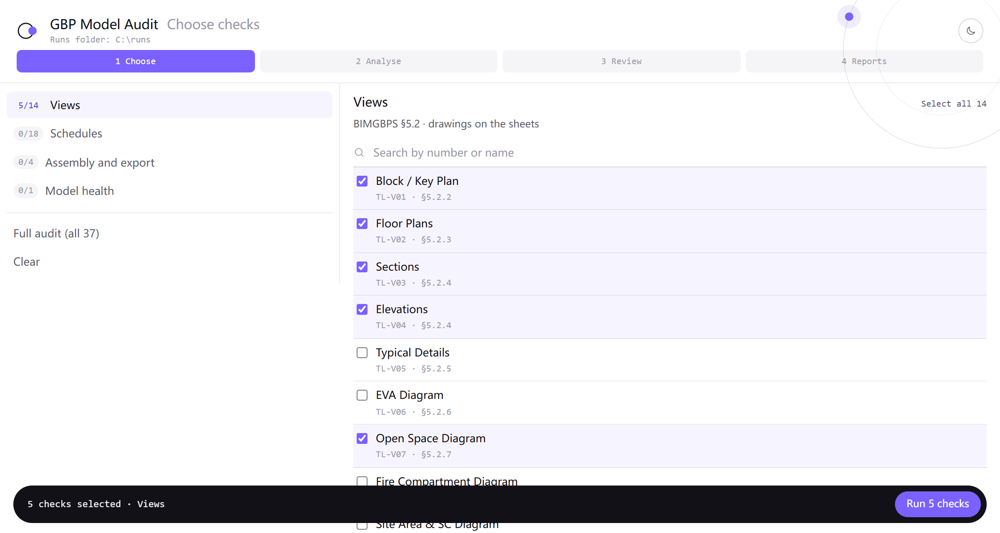
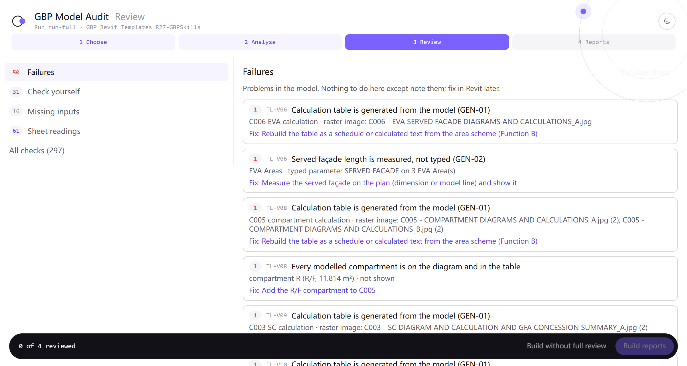

# GBP Model Audit

A read-only audit package for Revit models prepared for a Hong Kong GBP (general building plans) Stage I submission.
It checks the 36 BIMGBPS tasks (TL-S01–S18, TL-V01–V14, TL-A01–A04) and model health (MA-1 to MA-7) through a Revit MCP
server, and writes an English report in two editions (BIM team, AP / client).

香港 GBP 入则 Revit 模型只读审核包：按 BIMGBPS 36 个 Task 与模型健康 MA-1 至 MA-7，通过 Revit MCP 取数，出 BIM 团队版与 AP / 客户版英文报告。


https://github.com/user-attachments/assets/f34f77bf-a4f4-4862-89c0-07189c292e10


## Contents

| Folder | What |
| --- | --- |
| [model-audit/](model-audit/) | The package: four layers (L1 domain, L2 task logic, L3 Revit SOP, L4 MCP capabilities), executable tools, report templates, Agent Skills and an optional chat window (`model-audit/app/`, an MCP App). Start with [model-audit/README.md](model-audit/README.md) and [model-audit/RUN.md](model-audit/RUN.md). |
| [model-audit-design/](model-audit-design/) | Design and plan documents. |

## Quick start

**1. Folder layout.** Clone this repository and open its root folder as the agent's workspace (Claude Code, Cursor,
Codex, Hermes, …). The package looks for the source texts and writes its runs next to `model-audit/`:

```
<repo root>/              ← open this folder in the agent
  model-audit/            the package (RUN.md is here)
  model-audit-runs/       one folder per audit (the chat window looks here)
  Legislation/            you add: cap123, cap123f, cap123h, cap123i
  source/                 you add: BIMGBPS corpus, PNAPs
```

Without `Legislation/` and `source/` the audit still runs, but every compliance (L2) check is reported UNCLEAR.

**2. Revit and the MCP server.**

- Open a **copy** of the model in Revit, not the central file you will submit. The audit only reads.
- Start a Revit MCP server and connect it to your agent. Two have capability bindings:
  Autodesk revit-mcp and mcp-servers-for-revit (see [model-audit/L4-Capabilities/](model-audit/L4-Capabilities/)).
  With any other MCP the agent stops and tells you; a binding is made first with
  [CAP-onboarding](model-audit/L4-Capabilities/CAP-onboarding.md).
- Check that the agent can see the Revit tools, and that it can run Python 3.

**3. First instruction.** In the agent, say:

> Run a full Model Audit on the open model. Follow `model-audit/RUN.md`. Read-only. Write the run to
> `model-audit-runs/audit-<date>/`.

On the first run the agent copies the six Agent Skills into the workspace's skill folder (RUN.md §1 step 0); they
take effect in a new conversation. Prompts for one group, one task or a regression are in
[model-audit/RUN.md](model-audit/RUN.md) §7. The package docs write the package folder as `Model Audit/`: read it as
`model-audit/`.

## Chat window (optional)

`model-audit/app/` is a small MCP server (`gbp-audit`, an MCP App) that opens windows inside the chat and walks the
audit in four steps: 1 Choose › 2 Analyse › 3 Review › 4 Reports.

- **Choose checks**: pick tasks by BIMGBPS section (Views, Schedules, Assembly and export, Model health), or a full
  audit, as a new audit or added to an earlier one; *Run* sends the instruction to the agent.
- **Review**: the confirmation gate after the analysis. Failures, UNCLEAR checks and missing inputs are ticked off;
  each sheet reading is marked *Correct* or *Wrong* against its crop image. The review is saved with the run and the
  reports name anything not checked.

| Choose checks | Review |
| --- | --- |
|  |  |

To use it: Node.js 20 or later, `npm install && npm run build` in `model-audit/app/`, then register `build/index.js`
with your agent as [model-audit/app/README.md](model-audit/app/README.md) shows. The window is not required: the same
audit runs from the text prompts in [model-audit/RUN.md](model-audit/RUN.md) §7.

## Requirements

- A Revit model opened in Revit with a Revit MCP server connected to your agent (revit-mcp; mcp-servers-for-revit for element data).
- Python 3 (standard library; Pillow for colour sampling).
- Optional: Node.js 20 or later for the chat window ([model-audit/app/](model-audit/app/README.md)).
- The legislation and BIMGBPS source texts are **not** included; the package expects them next to it (`../Legislation/`, `../source/`) and reports UNCLEAR without them.

## Status

Validated on one sample model (the BD GBP Revit template). Not yet tried on other projects. Results are an aid to the
BIM / AP review, not a Buildings Department approval.
